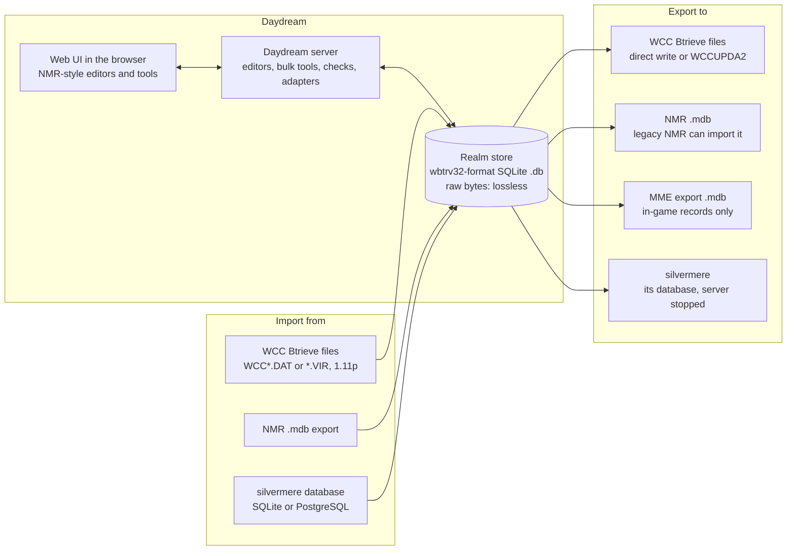

# Daydream: technical approach for an NMR rebuild

As of 2026-11-22.

## Summary

Daydream should be a cross-platform web editor whose working copy of a realm is SQLite, with lossless import from and export back to MajorMUD 1.11p WCC Btrieve data. NMR's editors, tools and MME export are carried over with the same names and layout so NMR users feel at home. The repo is empty today (one commit, a license), but silvermere already has a pure-Rust Btrieve reader, the 1.11p record layouts and a normalized SQLite/PostgreSQL schema to build on, and Paladine's [wbtrv32](https://github.com/mbbsemu/wbtrv32) already stores Btrieve data losslessly in SQLite and lets legacy NMR run against it.

The guiding rule: whatever Daydream edits, there must always be a proven way back to the WCC databases a real realm runs on.

## Requirements

These come from long-time NMR and MME users, and every design choice below is checked against them.

| # | Requirement | What it means in practice |
| --- | --- | --- |
| 1 | Backward compatible with WCC v1.11p at minimum | Read and write the 1.11p Btrieve record layouts byte for byte, including unknown fields NMR preserves |
| 2 | Platform agnostic | One store every OS can open (SQLite); the app runs in a browser on Windows, macOS and Linux |
| 3 | A guaranteed path back to WCC databases | Every edit can be turned back into `WCC*.DAT` data, directly or through NMR's `.mdb` export format so legacy NMR can import it |
| 4 | Familiar to NMR users | Same editor names, tabs, field labels and tools (Universal Modifier, Mass Room Editor, Quest Organizer) |
| 5 | Protect sysops' creative work in the MME export | The MME data file keeps NMR's rules: only reachable, in-game records, excluded rooms dropped, derived values instead of raw scripts |
| 6 | Edit any realm with a MajorMUD-like schema | Stock 1.11p, custom realms, and silvermere's SQLite/PostgreSQL stores |

## Where things stand

Nothing in Daydream yet; the useful pieces live in other projects.

| Project | What it gives Daydream | Limits to know |
| --- | --- | --- |
| Nightmare Redux (VB6, v1.8.3) | The feature list, field labels, the record layouts in `modFieldmaps*.bas` (1.11h to 1.11p), the `.mdb` export/import format, the MME export rules | Windows only; writes live `WCC*.DAT` through `WBTRV32.DLL`, then compiles `WCCUPDA2.DAT` to apply changes |
| silvermere (Rust) | A pure-Rust Btrieve reader, decoders for every 1.11p table, a normalized schema for SQLite and PostgreSQL | Read only for Btrieve; its schema drops unknown byte spans and session-only fields, so it is not lossless on its own |
| wbtrv32 (C++) | A drop-in `WBTRV32.DLL` that stores Btrieve files in SQLite (raw record bytes plus key columns) | Converts `.DAT` to SQLite one way only; the original files are never written |
| MMUD Explorer (VB6) | The consumer of NMR's MME export: an Access `.mdb` (for example `data-v1.11p.mdb`) that player clients also ingest | Format is defined by what MME reads, so it must not change |

How NMR protects sysops today: its MME export walks the world from the rooms outward and only exports records it can reach in game (placed items, shop stock, monsters in room regen groups, drops, spells taught or cast, textblocks run from rooms, items and spells). Excluded rooms are removed along with anything only they reference. It also writes derived values (average damage, lair exp) rather than the raw scripts behind them.

## Architecture

Daydream edits a SQLite store per realm, and every other format is an adapter that reads into it or writes out of it.

- **Realm store.** SQLite, in the format of Paladine's WBTRV32.DLL replacement (wbtrv32): one `.db` per WCC file, each record kept as its raw bytes plus its Btrieve key columns. That is lossless by construction, it is what MBBSEmu-hosted realms already run on, and legacy NMR can open it through the same DLL. Daydream decodes those bytes into silvermere's normalized tables for editing, so the two projects still share one data model.
- **Btrieve adapter.** Start from silvermere's Rust record decoders (copied into this repo) and add encoders. Write records through wbtrv32's C++ Btrieve library (MIT) so key columns stay right, and use its converter to turn a realm's `.DAT` files into `.db` files. wbtrv32 only converts one way and never touches the originals, so Daydream owns a writer back to `.DAT` (or a `WCCUPDA2.DAT` compiler), checked byte for byte against the originals.
- **NMR `.mdb` adapter.** Read and write NMR's export format, so the path back to WCC works through legacy NMR from day one, as the fallback while the `.DAT` writer matures.
- **MME export.** Port NMR's reachability walk and room exclusions as they are, so that protection is the default, not an option. The output matches exactly what MME reads today.
- **silvermere adapter.** Write straight into silvermere's SQLite or PostgreSQL database while the server is stopped. Daydream takes silvermere's own single-writer guard (the `.lock` file, or the PostgreSQL advisory lock) so it refuses to write while `serve` is running.
- **Stack.** A Rust server (ships as one binary per OS) serving a TypeScript web UI. It runs locally and opens in the browser, so no install of Btrieve, Access or VB6 runtimes is needed.

## Feature parity with NMR

Every NMR editor and tool has a home in Daydream; the milestone column says when it lands.

| NMR feature | Daydream equivalent | Milestone |
| --- | --- | --- |
| Item, Monster, Spell, Class, Race, Shop editors | Same editors, same tabs and field labels, list on the left, record on the right | M2 |
| Room editor and map editor | Room editor with a graphical map, exits drawn from the room records | M3 |
| Messages, Textblocks, Actions | Text editors with ANSI preview | M2 |
| Quest Organizer | Textblock tree grouped by quest, from the same links NMR follows | M3 |
| Users, Banks, Gangs | Player data editors, including Revive Character and clipboard import/export | M4 |
| Universal Modifier, Mass Room Editor | Bulk edit with a preview of every changed record before it is applied | M3 |
| Exp multiply/divide, no limiteds, no level limits, reset kill times, drop % modifier | Bulk presets built on the Universal Modifier | M3 |
| Limited item list, find item in rooms, control rooms list | Reports, exportable as CSV | M3 |
| Database import, export, delete, merge (by record range) | The same, using NMR's `.mdb` format so files move between NMR and Daydream | M1 |
| Export to MMUD Explorer | Same reachability rules and output, verified against NMR's own output | M4 |
| Compile Update File (`WCCUPDA2.DAT`) | Write the WCC files directly, or compile the update file the realm applies at startup | M5 |
| Monster attack sim, swing and exp calculators | Ported once the editors are done | Later |

## Validation

Correctness is proven four ways, and experienced NMR users sign off at each milestone before it ships.

1. **Round-trip tests.** Import the stock 1.11p `.VIR` set and several real realms, export them back to WCC files, and compare byte for byte. Any difference fails the build. Records with unknown fields must survive unchanged.
2. **Differential testing against real NMR.** NMR 1.8.3 runs on Windows (or Wine) in CI with wbtrv32 in place of Pervasive's DLL, so no Btrieve install is needed and both tools read the same `.db` files. The same realm goes through both tools for each operation, and the outputs are compared:
   - NMR's `.mdb` export versus Daydream's `.mdb` export of the same record ranges
   - NMR's MME export versus Daydream's MME export, table by table and value by value
   - A Universal Modifier run in NMR versus the same bulk edit in Daydream
   - NMR importing a Daydream `.mdb`, and Daydream importing an NMR `.mdb`
3. **Community test corpus.** Content creators publish realm edits on the [MudInfo forum](https://www.mudinfo.net/viewforum.php?f=47). Run each one through the round-trip and differential tests above, so real custom realms are covered, not just the stock data. Keep only edits whose authors allow reuse in a public repo, or fetch them at test time instead of committing them.
4. **Human review.** Automated checks catch format errors, not judgment errors. At the end of each milestone, long-time NMR users get a build and a checklist of what to try: what looks wrong, what is missing, what depends on what. Their findings become test cases.

**Keeping CI fast.** These checks must never become a bottleneck, so CI does the least work a change needs:

- **Build fixtures once.** Converted `.db` realms, NMR's reference exports and the stock data are built once, keyed by a hash of their inputs, and reused from a cache until an input changes.
- **Reuse binaries.** The Daydream server, wbtrv32 and the Wine image with NMR installed are cached build outputs, not rebuilt on every run.
- **Run what the change touches.** A change to the item encoder runs the item round-trip and item differential tests, not every table. Docs-only and UI-only changes skip the data suites.
- **Full suite off the critical path.** The complete differential run over every realm runs nightly and before a release, not on each pull request.
- **A time budget.** Pull request checks get a target time (10 minutes is a starting proposal), and a check that grows past it is split or moved to the nightly run.

silvermere followed the same pattern: recordings of the original game in its test suite, plus early players reporting what was missed.

## Milestones and first work

The path back to WCC exists from M1 through NMR's `.mdb` format, so no milestone strands a sysop's work while the direct Btrieve writer matures. Each milestone ships only after its gate passes.

| Milestone | Scope | Gate |
| --- | --- | --- |
| M1 Foundation (next) | Repo, Rust server, wbtrv32 `.db` store, decoders from silvermere; NMR `.mdb` import and export, round-trip test harness | 1.11p round-trips via NMR's `.mdb` import |
| M2 Core editors | Item, monster, spell, class, race and shop editors with NMR's labels; messages, textblocks and actions with ANSI preview | NMR users review the core editors |
| M3 World tools | Rooms and map, Quest Organizer, Universal Modifier, Mass Room Editor; bulk presets and reports | Bulk edits match NMR on the same realm |
| M4 Players and MME export | Users, banks and gangs, including Revive Character; MME export with NMR's reachability walk and room exclusions | MME export matches NMR's, value by value |
| M5 Direct WCC write | Write a realm's `WCC*.DAT` files straight from the store, adds, deletes and renumbers included, with no `WBTRV32.DLL` or NMR needed; silvermere adapter writing straight into its database while it is stopped | Real Btrieve (Pervasive's engine, as NMR and Worldgroup run it) reads every written file back key by key exactly as Daydream wrote it; unchanged files stay byte for byte as they were |
| M6 MCP server | Daydream as an MCP server, so AI agents can read a realm and create content (items, monsters, rooms, text blocks, quests) through the same checks and previews the editors use | An agent builds a small area end to end; every write is previewed, validated and undoable, and lands exactly as the same edit made in the editors |

### M5: writing WCC files directly

The M1 spike (`docs/dat-writer.md`) edits existing records in place, which keeps every index valid because no key changes. M5 covers the rest: new records, deleted records and renumbered ones, which change the index trees.

- **Rebuild a changed file, don't patch its trees.** A file whose keys changed is written anew from its records: data pages, then each key's B-tree built bottom up from the sorted keys, then the FCR (and on v6 files the PAT and both FCR copies). The page size, keys, ACS and flags come from the original file, so the new file is the same kind of file. Building from sorted keys is simpler and safer than inserting into Btrieve's live trees, and BUTIL's own clone and load work the same way. The realm is stopped while Daydream writes, so a whole-file rewrite costs nothing extra.
- **Touch only what changed.** A file whose records did not change is not written. A file whose changes leave every key alone keeps the in-place update from the spike, so its bytes change only where its records did.
- **Order of work.** (1) v5 fixed-length files, which most WCC files are; (2) v6 files (two FCRs, the PAT, usage counts); (3) variable-length files (`WCCTEXT`'s fragment pages); (4) `daydream write-dat` on the command line and a "Write to WCC files" button in the browser, writing to a copy of the realm's folder or over it with a backup.
- **Proof.** The Windows CI job already runs Pervasive's 6.15 engine. Each rebuilt file is read back through it, key by key, and must return the records Daydream wrote in the order Daydream's index walk gives. Daydream's own index checker runs on every file in the Linux job. Real NMR opening the written realm is the last check.
- **`WCCUPDA2.DAT`.** Compiling the update file is not needed once the files are written directly; it stays out of scope unless a sysop needs a live realm updated at its next start.

### M6: an MCP server for AI agents

Daydream will speak the Model Context Protocol, so an AI agent (Claude Code, Claude Desktop or any MCP client) can build content in a realm: a new area with its rooms, monsters, items, shops and text blocks, or a quest line.

- **Same path as the editors.** Every tool calls the library calls the web UI uses. Writes go through the strict import, references are checked (an exit to a missing room, a drop of a missing item), and nothing bypasses the write lock.
- **Preview, then apply.** Each write tool returns a preview of every change (the Universal Modifier's format) and a token; a second call applies it. An applied change is recorded with what it replaced, so it can be undone.
- **Tools, not raw records.** Agents get NMR-level tools: find a free record number, create or update a record by NMR's field names, dig rooms on the map, place monsters and items, write a text block with its commands checked, run NMR's fixes and lists, and read the map. Resources describe the tables, their columns and choice lists, so an agent writes valid values.
- **Local and opt-in.** `daydream mcp REALM` runs over stdio for a local agent; the server can also offer it over HTTP on localhost. Player tables (users, bank books, gangs) are off unless asked for. The MME export rule is unchanged: MCP gives an agent nothing the editors do not.
- **Gate.** An agent builds a small area end to end; the result passes Daydream's checks, opens in the editors and the map, and round-trips through the WCC writer.

First pieces of work, in order:

1. Make the Daydream repo public, with this approach as its design doc.
2. Copy silvermere's Btrieve reader and 1.11p decoders into Daydream (both are MIT, by the same author), leaving silvermere and its forks untouched, and read and write records in wbtrv32's `.db` format so they round-trip. Alongside it, spike a Btrieve `.DAT` writer on one file (items) to learn early whether direct writes are feasible.
3. Write the NMR `.mdb` reader and writer, and a CI job that runs real NMR to import Daydream's output (the first differential test).
4. Build the Item editor end to end as the template for every other editor, and put it in front of NMR users early.

## Decisions

| Question | Decision |
| --- | --- |
| Which MajorMUD versions at launch? | Only 1.11p |
| Write `WCC*.DAT` directly, or is an NMR-compatible `.mdb` enough? | Aim for direct `.DAT` writes: spike a writer early, keep the `.mdb` path as the fallback |
| How does M5 add, delete and renumber records? | Rebuild a changed file from its records, keeping its page size, keys and flags; patch in place when no key changes; leave unchanged files alone |
| Should AI agents be able to create content? | Yes, through an MCP server (M6), after M5, using the editors' own checks and previews |
| Does the MME export format change? | No: exactly as MME reads it today |
| How are silvermere realms edited? | Straight into its database file while the server is stopped |
| Can Daydream write a realm's `.db` files while MBBSEmu has them open? | Working assumption: stop the realm first, until tested |
| Does the writer back to `.DAT` live in wbtrv32? | No: Daydream owns it |
| Are GreaterMUD or Paramud data in scope? | Not for now |
| Native store format? | wbtrv32's `.db` format |
| Repo | Public, named Daydream |
